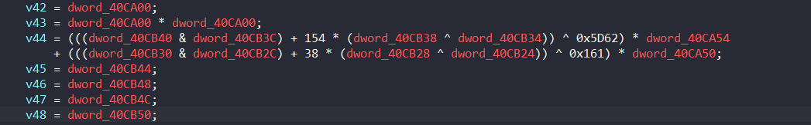
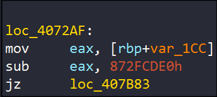

Đây là bài **hướng dẫn viết post** (đang để `draft: true`, nên chỉ thấy khi chạy `npm run dev`). Xoá thư mục `content/posts/notes/markdown-guide/` khi không cần nữa.

## Text

Chữ **đậm**, *nghiêng*, ***đậm nghiêng***, ~~gạch ngang~~, ==highlight==, `inline code`, và <kbd>Ctrl</kbd> + <kbd>C</kbd>.
Link thường [GitHub](https://github.com), link nội bộ [tất cả bài viết](../../../../tags/) và autolink https://example.com/docs.
Ngắt dòng cứng bằng hai dấu cách hoặc `\` ở cuối dòng.

> Blockquote thường. Có thể lồng **markdown** bên trong.

---

## Code blocks

Cú pháp: ba dấu backtick + tên ngôn ngữ. Hỗ trợ `c cpp python js ts rust go java bash bat powershell sql json yaml toml html css asm lua diff markdown`.

```c
#include <stdio.h>

int main(void) {
    printf("hello, %s\n", "world"); // a comment
    return 0;
}
```

Thêm `title="..."` và `{dòng-nổi-bật}`:

```python title="solve.py" {2,4-5}
import struct
key = bytes.fromhex("f630aa38")
for i, b in enumerate(key):
    print(i, hex(b))
    print(struct.pack("<I", b))
```

```rust
fn main() {
    let v: Vec<u32> = (1..=5).collect();
    println!("{:?}", v);
}
```

```go
package main

import "fmt"

func main() { fmt.Println("hi") }
```

```bash
$ gcc -O2 main.c -o main && ./main
```

```bat
@echo off
REM batch example
set NAME=world
echo hello %NAME%
```

```diff
- old line
+ new line
```

Thêm `nolines` để ẩn số dòng, `nocopy` để ẩn nút copy:

```asm nolines
mov eax, 0x1337   ; comment
xor ebx, ebx
```

## Callouts

> [!NOTE]
> Ghi chú thường. Dùng `[!NOTE]`, `[!TIP]`, `[!IMPORTANT]`, `[!WARNING]`, `[!CAUTION]`.

> [!TIP] Tiêu đề tuỳ chọn
> Viết thêm chữ sau tên để đổi tiêu đề.

> [!IMPORTANT]
> Điều quan trọng.

> [!WARNING]
> Cẩn thận chỗ này.

> [!CAUTION]
> Nguy hiểm!

> [!NOTE]- Gập lại (thêm dấu `-`, hoặc `+` để mở sẵn)
> Nội dung ẩn bên trong.

## Containers

:::details Bấm để mở rộng
Nội dung có thể chứa **markdown**, danh sách, code…

```js
console.log("inside a fold");
```
:::

:::details+ Mở sẵn (dùng `details+`)
Khối này mở sẵn.
:::

## Lists and tasks

- Gạch đầu dòng
  - Lồng nhau
- Mục khác

1. Danh sách có số
2. Mục hai

- [x] Task đã xong
- [ ] Task chưa xong

## Table

| Algorithm | Block size | Notes |
| :-------- | ---------: | :---: |
| AES       |         16 | fast  |
| ChaCha20  |         64 | `ARX` |
| TEA       |          8 | tiny  |

## Images

Ảnh đặt trong thư mục `img/` cạnh `index.md`. Có chú thích khi có title, đổi cỡ bằng `{width=...}`. Bấm vào ảnh để phóng to.



{width=320}

## Math

Bật bằng `math: true` ở đầu file. Inline $e^{i\pi} + 1 = 0$ và khối:

$$
\sum_{k=1}^{n} k = \frac{n(n+1)}{2}
$$

## Footnotes

Chú thích cuối trang[^1] và cái thứ hai[^note].

[^1]: Nội dung chú thích đầu tiên.
[^note]: Tên nhãn tuỳ ý, số thứ tự tự động.
