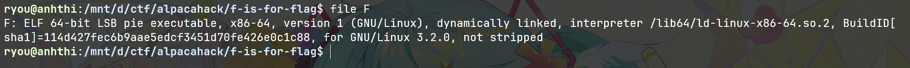
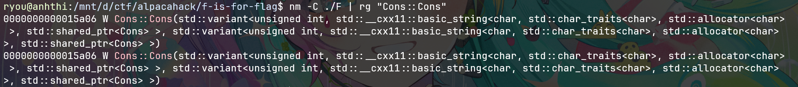

First of all this challenge is derived from SECCON contest but it is archieved and showed up on alpacahack website so I'm gonna call it alpacahack challenge

Link to the challenge: https://alpacahack.com/challenges/f-is-for-flag

## Overview

Well, it has been a long time since the last reverse engineering challenge I did, about 2 months I guess and this challenge is kind of fun so I'm gonna discuss about it



When I look at this, no stripped? dynamically linked? This would be easy challenge but reality shocked me, it is C++ a nearly worst language for revere engineering, the structure is similar to be obfuscated because of the overloading feature as well as OOP layout

Nevermind let's just do more recon, the challenge is simply a flag checker, run the binary, type the correct input to retrieve the flag

The challenge program header or section header seems to be normal. 

In main, this part is used to get input

```C++
std::string::basic_string(buffer, argv, envp);
std::operator<<<std::char_traits<char>>(&std::cout, "FLAG: ");
std::operator>><char>(&std::cin, buffer);
```

The challenge keeps overusing `lambda` function, `std::variant`, `std::function` and many more

Scrolling down to the end of main function
```C++
v3 = operator<<(&std::cout, output);
std::ostream::operator<<(v3, &std::endl<char,std::char_traits<char>>);
```
This part is used to print `Correct` or `Wrong`, and output was affected by this function 

```C++
main::{lambda(std::variant<unsigned int,std::string,std::shared_ptr<Cons>>,std::function<std::variant<unsigned int,std::string,std::shared_ptr<Cons>> ()(void)>,std::function<std::variant<unsigned int,std::string,std::shared_ptr<Cons>> ()(void)>)#1}::operator()(
(__int64)output,
(__int64)&v13,
(__int64)CheckerFlag,
(std::_Function_base *)v65,
(std::_Function_base *)v66
);
```

Because I rarely reverse these kind of C++ feature so I don't know how does it work, so I have an idea, I will write a small C++ program using `std::function` and `lambda` to understand the layout

```C++
#include <iostream>
#include <functional>

using namespace std;

struct MyStruct
{
    int operator()(int a, int b)
    {
        return a + b;
    }
};

int main() {

    std::function<int(int, int)> f = MyStruct{};

    cout << f(1, 2) << "\n";
    int res = [](int a, std::function<int(int, int)> func)
    {
        return func(a, 5);
    }(10, f);

    cout << res << "\n";
}
```

Okay let's talk about theory a little bit, actually `lambda` in C++ is no more than a class with overloaded `operator()`

For example a lambda function like this
```C++
auto lambda = [](int a, int b) {
    return a + b;
};
cout << lambda(1, 2);
```
Could be nearly this 
```C++
class Lambda {
    int operator()(int a, int b){
        return a + b;
    }
};
int main() {
    Lambda lm;

    cout << lm(1, 2);
    return 0;
}
```
If a lambda is defined with captured variable, it will be a element stored in class `Lambda` respectively

Now let's compile and load it into IDA to see how IDA resolve it

```C++
int __fastcall main(int argc, const char **argv, const char **envp)
{
  // [COLLAPSED LOCAL DECLARATIONS. PRESS NUMPAD "+" TO EXPAND]

  v11 = __readfsqword(0x28u);
  std::function<int ()(int,int)>::function<MyStruct,void>(v9, &v7);
  v3 = std::function<int ()(int,int)>::operator()(v9, 1, 2);
  v4 = std::ostream::operator<<(&std::cout, v3);
  std::operator<<<std::char_traits<char>>(v4, &unk_2004);
  std::function<int ()(int,int)>::function(v10, v9);
  v8 = main::{lambda(int,std::function<int ()(int,int)>)#1}::operator()(&v7, 10, v10);
  std::function<int ()(int,int)>::~function(v10);
  v5 = std::ostream::operator<<(&std::cout, v8);
  std::operator<<<std::char_traits<char>>(v5, &unk_2004);
  std::function<int ()(int,int)>::~function(v9);
  return 0;
}
```

So this part is likely triggering lambda function, as you can see it execute the `operator()`
```C++
main::{lambda(int,std::function<int ()(int,int)>)#1}::operator()
```
`10` is our argument so `v10` would be `std::function`, `v7` is something like self capture? `this` pointer? I don't know but we don't have to care, so inside that function is this

```C++
__int64 __fastcall std::function<int ()(int,int)>::operator()(std::_Function_base *a1, int a2, int a3)
{
  // [COLLAPSED LOCAL DECLARATIONS. PRESS NUMPAD "+" TO EXPAND]

  v9 = a1;
  v8 = a2;
  v7 = a3;
  if ( (unsigned __int8)std::_Function_base::_M_empty(a1) )
    std::__throw_bad_function_call();
  v3 = (__int64 (__fastcall *)(std::_Function_base *, __int64, __int64))*((_QWORD *)v9 + 3);
  v4 = std::forward<int>(&v7);
  v5 = std::forward<int>(&v8);
  return v3(v9, v5, v4);
}
```
There is a callback from `a1` which is `std::_Function_base` -> v7 is initialized before and there is a callabck assigned, so we look at where `v7` is first initialized

```C++
std::function<int ()(int,int)>::function<MyStruct,void>(v9, &v7);
```

Inside this function we can see this 
```C++
__int64 __fastcall std::function<int ()(int,int)>::function<MyStruct,void>(std::_Function_base *a1, __int64 a2)
{
  // [COLLAPSED LOCAL DECLARATIONS. PRESS NUMPAD "+" TO EXPAND]

  *(_OWORD *)a1 = 0;
  *((_QWORD *)a1 + 2) = 0;
  std::_Function_base::_Function_base(a1);
  *((_QWORD *)a1 + 3) = 0;
  result = std::_Function_base::_Base_manager<MyStruct>::_M_not_empty_function<MyStruct>(a2);
  if ( (_BYTE)result )
  {
    v3 = std::forward<MyStruct>(a2);
    std::_Function_base::_Base_manager<MyStruct>::_M_init_functor<MyStruct>(a1, v3);
    *((_QWORD *)a1 + 3) = std::_Function_handler<int ()(int,int),MyStruct>::_M_invoke;
    *((_QWORD *)a1 + 2) = std::_Function_handler<int ()(int,int),MyStruct>::_M_manager;
    return (__int64)a1;
  }
  return result;
}
```
There is an invoker assigned to `a1 + 3` so this is a callback function, traversal through this from
`_M_invoke` -> `std::__invoke_r` -> `std::__invoke_impl` we can access `MyStruct::operator()` which is our `operator()` <- main logic stays here

Alright using this findings back to the normal challenge we can see that  
`v65` is this lambda 
```C++
const char *main::{lambda(void)#3}::operator()()
{
  return "Wrong";
}
```
`v66` is this lambda
```C++
const char *main::{lambda(void)#4}::operator()()
{
  return "Correct";
}
```

After debugging you can figure out that the key here is this
```C++
main::{lambda(std::variant<unsigned int,std::string,std::shared_ptr<Cons>>,std::function<std::variant<unsigned int,std::string,std::shared_ptr<Cons>> ()(void)>,std::function<std::variant<unsigned int,std::string,std::shared_ptr<Cons>> ()(void)>)#1}::operator()((__int64)CheckerFlag, (__int64)&v13, (__int64)isEqual, (std::_Function_base *)v63, (std::_Function_base *)v64);                // likely checker main function

main::{lambda(std::variant<unsigned int,std::string,std::shared_ptr<Cons>>,std::function<std::variant<unsigned int,std::string,std::shared_ptr<Cons>> ()(void)>,std::function<std::variant<unsigned int,std::string,std::shared_ptr<Cons>> ()(void)>)#1}::operator()(
    (__int64)output,
    (__int64)&v13,
    (__int64)CheckerFlag,
    (std::_Function_base *)v65,
    (std::_Function_base *)v66);
```
The function above is the checker function

When debugging I saw that `CheckerFlag` is equal to `1` after jumping into the function so I decided to change it to zero to see what happened and boom, it prints `Correct`, so this is the function changes `CheckerFlag`

Next is how to define the input length? If we look into this 
```C++
std::variant<unsigned int,std::string,std::shared_ptr<Cons>>::variant<std::string&,void,void,std::string,void>(
    (__int64)data,
    (__int64)buffer);                           // likely assigning buffer to v131
main::{lambda(std::variant<unsigned int,std::string,std::shared_ptr<Cons>>)#4}::operator()(
    (__int64)length,
    (__int64)&v17,
    (__int64)data);
main::{lambda(std::variant<unsigned int,std::string,std::shared_ptr<Cons>>,std::variant<unsigned int,std::string,std::shared_ptr<Cons>>)#17}::operator()(
    (__int64)isEqual,
    (__int64)&v12,
    (__int64)length,
    (__int64)v69);       
```
It does something like copy our buffer into `std::variant<...> data`, then executing 2 lambda function
If we look at the first one it gets our input length
```C++
__int64 __fastcall main::{lambda(std::variant<unsigned int,std::string,std::shared_ptr<Cons>>)#4}::operator()(__int64 a1, __int64 a2, __int64 a3)
{
  v6 = __readfsqword(0x28u);
  v3 = std::get<std::string,unsigned int,std::string,std::shared_ptr<Cons>>(a3);
  v5 = std::string::size(v3);
  std::variant<unsigned int,std::string,std::shared_ptr<Cons>>::variant<unsigned int,void,void,unsigned int,void>(
    a1,
    &v5);
  return a1;
}
```
So input length is 0x40 aint no doubt

Alright back to now, everything seems to be harder because at this time I definitely blind about what does the program do so instead of static analysis we will trying to do something here

During the whole program you would see this

```C++
std::variant<unsigned int,std::string,std::shared_ptr<Cons>>
```
It is a `std::variant` and `std::shared_ptr` of `Cons` a likely custom struct so we can find where is its constructor, the easiest way to find this constructor is using `nm` because the binary is not stripped, if it is not stripped you could base on `std::make_shared` or some kind I'm not really know much about `C++` 



Something like this we could have the offset there
```C++
__int64 __fastcall Cons::Cons(__int64 a1, __int64 a2, __int64 a3)
{
  std::variant<unsigned int,std::string,std::shared_ptr<Cons>>::variant(a1, a2);
  return std::variant<unsigned int,std::string,std::shared_ptr<Cons>>::variant(a1 + 0x28, a3);
}
```
The main variable is likely `a2` or `a3` i don't know, we need to write a tracing script to dump all these value, there is many way for example gdbscript, gdb python but I will use `libdebug` for faster interaction

```python
#!/usr/bin/env python3

import subprocess, re, pwn
from libdebug import debugger, ThreadContext, Breakpoint

d = debugger("./F", aslr=False)
pipe = d.run()

base = d.maps[0].base

def bp_examine(t: ThreadContext, bp: Breakpoint):
    rsi = t.regs.rsi
    rdx = t.regs.rdx
    value = pwn.u32(t.mem[rsi, 4])
    print(f"RSI = {value:#x}")
    pass

d.breakpoint(position=0x15a06, hardware=False, callback=bp_examine, file='binary')

d.cont()

flag = b"aaaaaaaaaaaaaaaaaaaaaaaaaaaaaaaaaaaaaaaaaaaaaaaaaaaaaaaaaaaabbbb"
pipe.sendlineafter(b"FLAG:", flag)

d.wait()

d.kill()
```

We will see a really interesting stuff right there 
```log
RSI = 0xb7e9a2a4
RSI = 0x1904c652
RSI = 0xbe8afe4d
RSI = 0xbd18775a
RSI = 0x82841cf4
RSI = 0xd2c1d5af
RSI = 0xf389c4a
RSI = 0x451f151a
RSI = 0xd5689a8c
RSI = 0x927b5bd9
RSI = 0xf86c82d7
RSI = 0x34bc7c60
RSI = 0x97aef869
RSI = 0x2c0cccdd
RSI = 0x88d2ec9b
RSI = 0x11793013
RSI = 0x7
RSI = 0x0
RSI = 0xc
RSI = 0xd
RSI = 0x2
RSI = 0xf
RSI = 0xb
RSI = 0x8
RSI = 0x6
RSI = 0x5
RSI = 0x9
RSI = 0x4
RSI = 0xa
RSI = 0x1
RSI = 0xe
RSI = 0x3
RSI = 0x62626262
RSI = 0x61616161
RSI = 0x61616161
RSI = 0x61616161
RSI = 0x61616161
RSI = 0x61616161
RSI = 0x61616161
RSI = 0x61616161
RSI = 0x61616161
RSI = 0x61616161
RSI = 0x61616161
RSI = 0x61616161
RSI = 0x61616161
RSI = 0x61616161
RSI = 0x61616161
RSI = 0x61616161
....
```

First of all is 64 random buffer likely the target comparison array (because there are exactly 16 DWORD value)

And some array, at this period I will say that we could consider it is a permutation array using for substituting buffer, we need a mindset like this, for example sbox, addend, coefficient, ...

And next is our input, alright that this moment our mindset should be watching all following value to figure out the transformation (the program is likely performing many operation on `std::variant` and its custom struct so the leftover fingerprint for us to trace is absolutly huge)

Another mindset here is trying to hook every stuff of the binary for information, we need to understand what is program behavior, for example a single `cmp` instruction could help us understand what value is constantly compared, which value is dynamically changed during multiple runtime or tracing library call, tracing internal function (for example Constructor, Destructor, ...)

>[!Note]
>Dynamic analysis is not only using debugger, leverage every dynamic aspects of the binary is called dyanmic analysis 

After our input is presented, the next following buffer is 
```
RSI = 0x51515151
RSI = 0x5e5e5e5e
RSI = 0x5e5e5e5e
RSI = 0x5e5e5e5e
RSI = 0x5e5e5e5e
RSI = 0x5e5e5e5e
RSI = 0x5e5e5e5e
RSI = 0x5e5e5e5e
RSI = 0x5e5e5e5e
RSI = 0x5e5e5e5e
RSI = 0x5e5e5e5e
RSI = 0x5e5e5e5e
RSI = 0x5e5e5e5e
RSI = 0x5e5e5e5e
RSI = 0x5e5e5e5e
RSI = 0x5e5e5e5e
```
So remember `sbox` I said above? it replaces each 1 hex digit with the reversed array

```python
_sbox = [3, 14, 1, 10, 4, 9, 5, 6, 8, 11, 15, 2, 13, 12, 0, 7]
def sbox(inp):
    pack = bytearray(struct.pack("<16I", *inp))
    for i in range(len(pack)):
        x = pack[i] // 0x10
        y = pack[i] % 0x10
        pack[i] = _sbox[x] * 0x10 + _sbox[y]
    return list(struct.unpack("<16I", pack))
```
Like this 

Next is 
```
RSI = 0xb6e74789
RSI = 0xfa2f29ee
RSI = 0xfa2f29ee
RSI = 0xfa2f29ee
RSI = 0xfa2f29ee
RSI = 0xfa2f29ee
RSI = 0xfa2f29ee
RSI = 0xfa2f29ee
RSI = 0xfa2f29ee
RSI = 0xfa2f29ee
RSI = 0xfa2f29ee
RSI = 0xfa2f29ee
RSI = 0xfa2f29ee
RSI = 0xfa2f29ee
RSI = 0xfa2f29ee
RSI = 0xfa2f29ee
```
These is not any usual transform any more, so we need to inspect the callstack 
Like this
```python
def bp_examine(t: ThreadContext, bp: Breakpoint):
    rsi = t.regs.rsi
    rdx = t.regs.rdx
    value = pwn.u32(t.mem[rsi, 4])
    print(f"RSI = {value:#x}")
    for (a, s) in zip(t.backtrace(), t.backtrace(as_symbols=True)):
        if s.strip().startswith("main"):
            print(f"[{a - base:#x}] {s}")
    print("=" * 100)
```

We can see the function which is called right before the constructor is at `F + 0x8e67` (the log is painful so I wont show it here)

```C++
__int64 __fastcall ZZZ4mainENKUlT_St7variantIJjNSt7__cxx1112basic_stringIcSt11char_traitsIcESaIcEEESt10shared_ptrI4ConsEEESA_SA_E2_clISt17reference_wrapperIK3fixISB_EEEESA_S_SA_SA_SA_ENKUlvE0_clEv(
        __int64 a1,
        __int64 a2)
{
  __int64 v2; // rbx
  __int64 v3; // r12
  __int64 v4; // r14
  __int64 v5; // r13
  __int64 v6; // r12
  int v8; // [rsp+18h] [rbp-178h] BYREF
  int v9; // [rsp+1Ch] [rbp-174h] BYREF
  _BYTE v10[48]; // [rsp+20h] [rbp-170h] BYREF
  _BYTE v11[48]; // [rsp+50h] [rbp-140h] BYREF
  _BYTE v12[48]; // [rsp+80h] [rbp-110h] BYREF
  _BYTE v13[48]; // [rsp+B0h] [rbp-E0h] BYREF
  _BYTE v14[48]; // [rsp+E0h] [rbp-B0h] BYREF
  _BYTE v15[48]; // [rsp+110h] [rbp-80h] BYREF
  _BYTE v16[40]; // [rsp+140h] [rbp-50h] BYREF
  unsigned __int64 v17; // [rsp+168h] [rbp-28h]

  v17 = __readfsqword(0x28u);
  v2 = *a2;
  v3 = *(a2 + 40);
  v4 = *(a2 + 56);
  v5 = *(a2 + 48);
  v9 = 1;
  std::variant<unsigned int,std::string,std::shared_ptr<Cons>>::variant<unsigned int,void,void,unsigned int,void>(
    v14,
    &v9);
  std::variant<unsigned int,std::string,std::shared_ptr<Cons>>::variant(v13, *(a2 + 32));
  main::{lambda(std::variant<unsigned int,std::string,std::shared_ptr<Cons>>,std::variant<unsigned int,std::string,std::shared_ptr<Cons>>)#1}::operator()(
    v15,
    v5,
    v13,
    v14);
  ZNKSt17reference_wrapperIK3fixIZ4mainEUlT_St7variantIJjNSt7__cxx1112basic_stringIcSt11char_traitsIcESaIcEEESt10shared_ptrI4ConsEEESC_SC_E2_EEclIJRSC_SC_SI_EEENSt15__invoke_resultIRSF_JDpT_EE4typeEDpOSL_(
    v16,
    v3,
    *(a2 + 24),
    v15,
    v4);
  v6 = *(a2 + 8);
  v8 = 0x4E6A44B9;
  std::variant<unsigned int,std::string,std::shared_ptr<Cons>>::variant<unsigned int,void,void,unsigned int,void>(
    v11,
    &v8);
  ZNKR3fixIZ4mainEUlT_St7variantIJjNSt7__cxx1112basic_stringIcSt11char_traitsIcESaIcEEESt10shared_ptrI4ConsEEESB_SB_E_EclIJRSB_SF_EEEDcDpOT_(
    v10,
    *(a2 + 16),
    *(a2 + 24),
    *(a2 + 32));
  main::{lambda(std::variant<unsigned int,std::string,std::shared_ptr<Cons>>,std::variant<unsigned int,std::string,std::shared_ptr<Cons>>)#3}::operator()(
    v12,
    v6,
    v10,
    v11);
  main::{lambda(std::variant<unsigned int,std::string,std::shared_ptr<Cons>>,std::variant<unsigned int,std::string,std::shared_ptr<Cons>>)#19}::operator()(
    a1,
    v2,
    v12,
    v16);
  std::variant<unsigned int,std::string,std::shared_ptr<Cons>>::~variant(v12);
  std::variant<unsigned int,std::string,std::shared_ptr<Cons>>::~variant(v10);
  std::variant<unsigned int,std::string,std::shared_ptr<Cons>>::~variant(v11);
  std::variant<unsigned int,std::string,std::shared_ptr<Cons>>::~variant(v16);
  std::variant<unsigned int,std::string,std::shared_ptr<Cons>>::~variant(v15);
  std::variant<unsigned int,std::string,std::shared_ptr<Cons>>::~variant(v13);
  std::variant<unsigned int,std::string,std::shared_ptr<Cons>>::~variant(v14);
  return a1;
}
```

We can see that the last `operator()` affect our value, which is `a1`. Go back a little bit we see this
```C++
v8 = 0x4E6A44B9;
std::variant<unsigned int,std::string,std::shared_ptr<Cons>>::variant<unsigned int,void,void,unsigned int,void>(
  v11,
  &v8);
```
And `v11` is passed into  
```C++
main::{lambda(std::variant<unsigned int,std::string,std::shared_ptr<Cons>>,std::variant<unsigned int,std::string,std::shared_ptr<Cons>>)#3}::operator()(
  v12,
  v6,
  v10,
  v11);
```
Look at into this function it is
```C++
v8 = __readfsqword(0x28u);
v4 = *std::get<unsigned int,unsigned int,std::string,std::shared_ptr<Cons>>(a3);
v7 = v4 * *std::get<unsigned int,unsigned int,std::string,std::shared_ptr<Cons>>(a4);
std::variant<unsigned int,std::string,std::shared_ptr<Cons>>::variant<unsigned int,void,void,unsigned int,void>(
  a1,
  &v7);
return a1;
```

So the next transformation is multiplication with `0x4E6A44B9`, the 3rd transformation finding method is similar and there is only 3 transforming operation, it will repeat 8 times

The third one is likely
```python
def mix(inp, s):
    out = inp.copy()
    for i in range(13):
        idx = (s - i) % 0x10
        a, b, c, d = inp[idx], inp[(idx + 1) % 0x10], inp[(idx + 2) % 0x10], inp[(idx + 3) % 0x10]
        out[idx] = pwn.rol(d, 0x1d, 32) ^ pwn.rol(c, 0x11, 32) ^ pwn.rol(b, 0x7, 32) ^ a
    return out
```
Sorry I'm too lazy to write now T_T but it would be better if you find it yourself, enjoy your own "aha!" moment 

Full script
```python
#!/usr/bin/env python3

import struct, pwn

inpp = bytearray(b'aaaaaaaaaaaaaaaaaaaaaaaaaaaaaaaaaaaaaaaaaaaaaaaaaaaaaaaaaaaabbbb')

_sbox = [3, 14, 1, 10, 4, 9, 5, 6, 8, 11, 15, 2, 13, 12, 0, 7]
_inv_sbox = [0] * 16
for i in range(16):
    _inv_sbox[_sbox[i]] = i

word = list(struct.unpack("<16I", inpp))
def sbox(inp):
    pack = bytearray(struct.pack("<16I", *inp))
    for i in range(len(pack)):
        x = pack[i] // 0x10
        y = pack[i] % 0x10
        pack[i] = _sbox[x] * 0x10 + _sbox[y]
    return list(struct.unpack("<16I", pack))

def mul(inp):
    for i in range(len(inp)):
        inp[i] = (inp[i] * 0x4e6a44b9) & 0xffffffff
    return inp

def mix(inp, s):
    out = inp.copy()
    for i in range(13):
        idx = (s - i) % 0x10
        a, b, c, d = inp[idx], inp[(idx + 1) % 0x10], inp[(idx + 2) % 0x10], inp[(idx + 3) % 0x10]
        out[idx] = pwn.rol(d, 0x1d, 32) ^ pwn.rol(c, 0x11, 32) ^ pwn.rol(b, 0x7, 32) ^ a
    return out

lmao = 8

for _ in range(lmao):
    word = sbox(word)
    word = mul(word)
    word = mix(word, (_ + 12) % 0x10)
```
Now we just need to reverse this to get the solve script

Solve script
```python
#!/usr/bin/env python3

import struct, pwn

_sbox = [3, 14, 1, 10, 4, 9, 5, 6, 8, 11, 15, 2, 13, 12, 0, 7]
_inv_sbox = [0] * 16
for i in range(16):
    _inv_sbox[_sbox[i]] = i
base = [0xb7e9a2a4,0x1904c652,0xbe8afe4d,0xbd18775a,0x82841cf4,0xd2c1d5af,0xf389c4a,0x451f151a,0xd5689a8c,0x927b5bd9,0xf86c82d7,0x34bc7c60,0x97aef869,0x2c0cccdd,0x88d2ec9b,0x11793013]
word = base[::-1]

def inv_sbox(inp):
    pack = bytearray(struct.pack("<16I", *inp))
    for i in range(len(pack)):
        x = pack[i] // 0x10
        y = pack[i] % 0x10
        pack[i] = _inv_sbox[x] * 0x10 + _inv_sbox[y]
    return list(struct.unpack("<16I", pack))

inv_c = pow(0x4e6a44b9, -1, 1 << 32)
def inv_mul(inp):
    for i in range(len(inp)):
        inp[i] = inp[i] * inv_c & 0xffffffff
    return inp

def inv_mix(inp, s):
    out = inp.copy()
    for i in range(13):
        idx = (s - i) % 0x10
        # print(idx)
        a, b, c, d = out[idx], out[(idx + 1) % 0x10], out[(idx + 2) % 0x10], out[(idx + 3) % 0x10]
        out[idx] ^= pwn.rol(d, 0x1d, 32) ^ pwn.rol(c, 0x11, 32) ^ pwn.rol(b, 0x7, 32)
    return out

for _ in range(lmao - 1, -1, -1):
    word = inv_mix(word, (_ + 12) % 0x10)
    word = inv_mul(word)
    word = inv_sbox(word)

byte = struct.pack("<16I", *word)
print(byte)
```

Flag: `SECCON{fUnCt10n4l_pRoGr4mM1n6_1s_pR4c7iC4lLy_a_pUr3_0bfu5c4T1oN}`

`C++` is cleverly a unique obfuscation technique not gonna lie thanks who dev C++ 